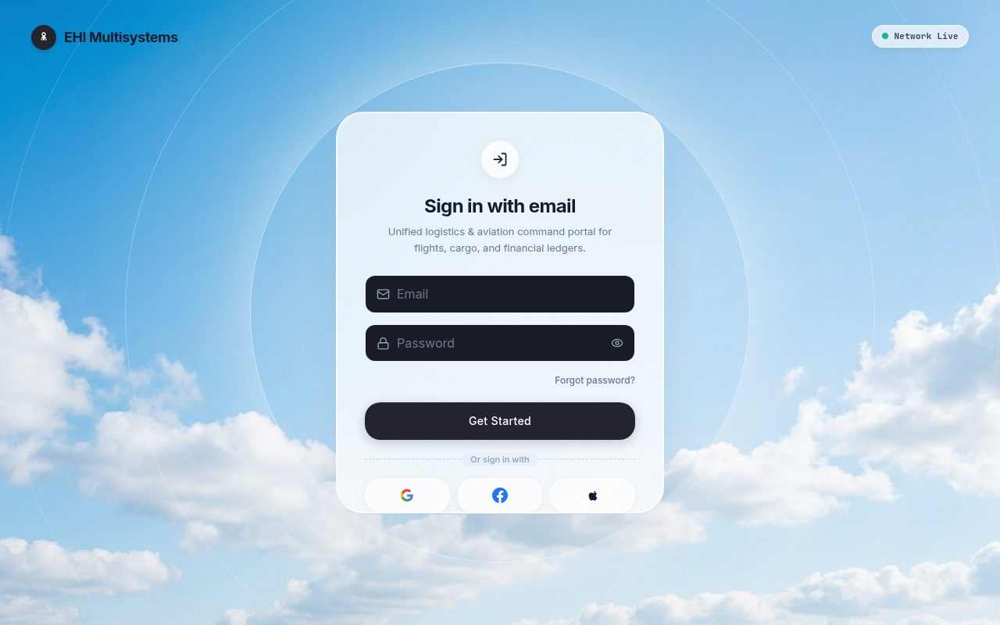
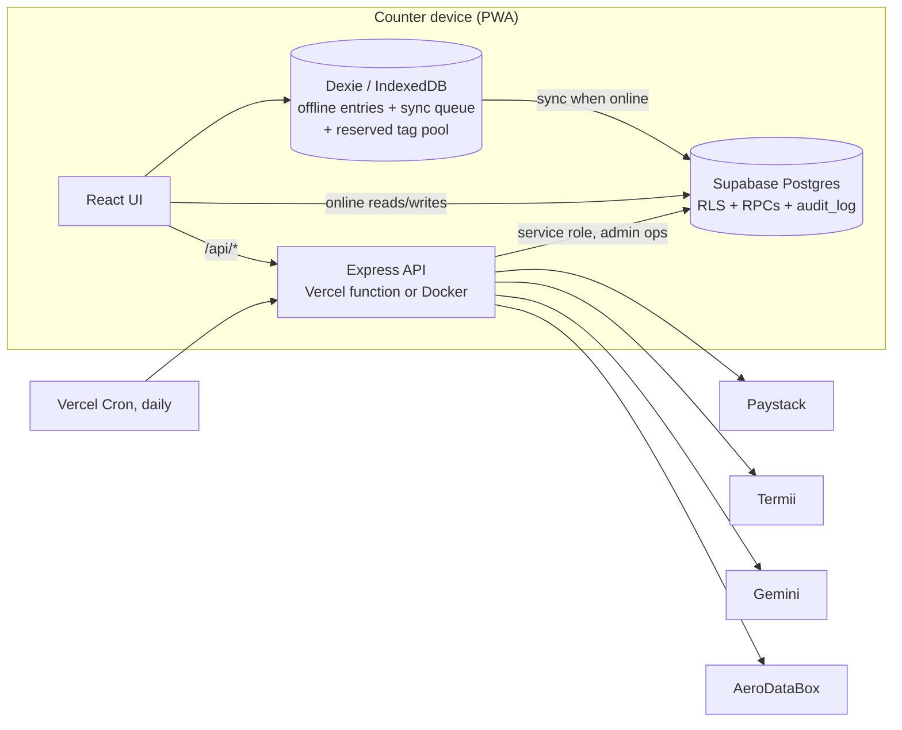

# EHI Multisystems

**An offline-first operations platform for an airline cargo General Sales Agent (GSA) in Lagos: cargo, excess baggage, packages, dispatch, wallets, debt and end-of-day reconciliation in one system.**

**Live:** https://ehi-multisystems-fl85.vercel.app (staff sign-in required)



> Screenshot shows the public sign-in page only. Every operational screen holds real customer and financial data, so none of them are shown here.

---

## The problem

A cargo GSA runs several counters at once (cargo intake, excess baggage, marketing and package desks) across multiple hubs, airlines and payment modes. Before this system, that work lived on paper, in spreadsheets and in people's heads. That made it hard to answer basic questions: who received this cash, which AWB went where, what is each corporate client owed, and does today's till match today's entries?

EHI Multisystems puts every counter, hub and role on one ledger. The business reports it cut losses by over 60% after adopting it.

## Key features

- **Counter workspaces** for cargo, excess baggage, GAT terminal, marketing and package desks, with airline- and route-specific rates, minimum charges, flat/size/special-goods tiers and per-hub rate overrides.
- **AWB and tag numbering** from an atomic server-side counter, with blocks pre-reserved per device so tags can still be issued offline without collisions.
- **Shipment custody chain**: QR scanning, arrivals, dispatch, incoming-to-hub, wrong-destination alerts and proof of delivery (signature, photo, GPS).
- **Customer wallets and debt**: top-ups, deductions, refunds, partial retrievals, corporate (B2B) billing and debt collection, with maker-checker approval for cash payouts and refunds.
- **Reconciliation**: end-of-day reports, cargo day close, bank reconciliation, payment validation from bank-alert emails, and office-work reconciliation.
- **Printing**: ESC/POS thermal receipts, waybills and tags, PDF reports (`@react-pdf/renderer`), Excel exports, and optional silent printing through QZ Tray.
- **Role-based access** for 9 staff roles (super admin, admin, accountant, auditor, cargo/baggage/marketing agents, driver, office work), plus per-staff view overrides.
- **Analytics and oversight**: dashboards, airline performance and commissions, forecasting, fraud alerts, a searchable audit log, and a Flight Radar departures board (AeroDataBox).
- **AI assistant** (Google Gemini, server-side) for insights, report narratives and PDF parsing.
- **Installable PWA** for counter tablets and phones.

## Tech stack

| Layer | Tools |
| --- | --- |
| Frontend | React 19, TypeScript, Vite 6, Tailwind CSS v4, React Router 7, Motion, Recharts, Leaflet, TanStack Virtual |
| Offline | Dexie (IndexedDB), `vite-plugin-pwa` / Workbox |
| Backend | Express (`server/`), deployed as a Vercel serverless function (`api/index.ts`) or as a Docker container |
| Database & auth | Supabase (Postgres, Auth, Realtime, RLS, `SECURITY DEFINER` RPCs) |
| Integrations | Paystack, Termii (SMS), Google Gemini, AeroDataBox, QZ Tray, Sentry |
| Documents | `@react-pdf/renderer`, ExcelJS / SheetJS, PapaParse, QR codes |

## Architecture



- `src/components/views/`: one view per workspace (CargoForm, TransactionLedger, CustomerWallets, EODReconciliation, ...).
- `src/lib/`: domain logic (rates, debt, wallet, scan logic, ESC/POS printing, permissions, offline sync).
- `server/`: Express routers for staff admin, payments, notifications, AI, Flight Radar, QZ signing and EOD.
- `supabase/migrations/`: 124 SQL migrations, applied in filename order (see `docs/MIGRATION_POLICY.md`).

## Notable engineering decisions

Each item below is backed by code in this repo.

- **Money is stored as `NUMERIC`, never float.** For example, `NUMERIC(12,2)` for corporate debt and `NUMERIC(10,2)` for per-kg rates (`supabase/migrations/20260623_corporate_billing.sql` onwards).
- **Row-level security enforces hub isolation in the database.** `20260708_hub_isolation_rls.sql` replaced app-level `.eq('hub_id', …)` filters with RLS. Staff can only touch their own hub's records unless their role is explicitly cross-hub. The migrations define about 200 `CREATE POLICY` statements.
- **Offline mirror with a durable sync queue.** Entries go to Dexie first and are pushed when the device is back online (`src/lib/db.ts`, `src/lib/sync.ts`). Postgres errors are classified: permanent ones (check/not-null/bad-type) are quarantined rather than retried forever, and FK violations get bounded retries in case a hub rename is still in progress.
- **Collision-free tag numbers while offline.** Devices reserve blocks from an atomic `reserve_awb_block` RPC and then pop numbers locally (`src/lib/tagPool.ts`).
- **A tamper-resistant audit trail.** An `audit_log` table and viewer record who did what. A later hardening migration (`20260912_wallet_and_audit_integrity_hardening.sql`) added a server-side check that a row's `user_id` matches `auth.uid()`, so staff cannot write entries in someone else's name.
- **Wallet integrity.** Wallet transactions take idempotency keys behind a partial unique index (`20260951_…`). Advisory locks serialize wallet matching, and cash payouts and refunds go through a maker-checker flow that records requester and approver from `auth.uid()`.
- **Applied migrations are tracked in the database.** Every migration ends by inserting its own filename into `schema_migrations`, and `supabase/VERIFY_LIVE_DB.sql` checks the live database against the repo.
- **Optional integrations fail closed.** A missing secret disables only its own feature: inbound webhook, cron, Flight Radar and QZ signing each return 503 instead of running unauthenticated.
- **Security headers** (`X-Frame-Options: DENY`, `nosniff`, a strict referrer policy and a permissions policy) are set in `vercel.json`.

## Running locally

**Prerequisites:** Node.js 20+ and a Supabase project.

```bash
npm install
cp .env.example .env.local   # fill in your own values; never commit real keys
npm run dev                  # tsx server.ts: Express + Vite middleware on http://localhost:3000
```

Environment variables (see `.env.example` for full notes):

| Variable | Required | Purpose |
| --- | --- | --- |
| `VITE_SUPABASE_URL`, `VITE_SUPABASE_ANON_KEY` | Yes | Supabase project (public anon key) |
| `SUPABASE_SERVICE_ROLE_KEY` | Yes (server only) | Staff admin operations that bypass RLS |
| `GEMINI_API_KEY` | For AI features | Google Gemini |
| `PAYSTACK_SECRET_KEY`, `TERMII_API_KEY` | Optional | Payments, SMS |
| `VITE_SENTRY_DSN` | Optional | Error monitoring |
| `INBOUND_WEBHOOK_SECRET` | Optional | Bank-alert email webhook |
| `AERODATABOX_API_KEY`, `CRON_SECRET` | Optional | Flight Radar and its daily cron |
| `QZ_CERTIFICATE`, `QZ_PRIVATE_KEY` | Optional | Silent printing via QZ Tray |
| `APP_URL` | Optional | Self-referential links |

Database setup: run `supabase/0000_schema_migrations_tracking.sql`, then the files in `supabase/migrations/` oldest first, then `supabase/VERIFY_LIVE_DB.sql` (details in `docs/MIGRATION_POLICY.md`).

Production build:

```bash
npm run build && npm start      # Vite build + bundled Express server (dist/server.cjs)
# or
docker build -t ehi . && docker run -p 8080:8080 -e PORT=8080 --env-file .env.local ehi
```

## Tests and quality checks

There is no automated test suite in this repo yet. Quality checks are:

- `npm run lint`: strict TypeScript type-check (`tsc --noEmit`)
- `npm run build`: production build of both the client and the server bundle
- `supabase/VERIFY_LIVE_DB.sql`: schema and migration verification against the live database

## Project history

Over 750 commits since June 2026 (from `git log`).

---

**Role:** built by **Sanni-Musa Emmanuel George**, full-stack developer and designer, Lagos.
[github.com/geosan11](https://github.com/geosan11) · [linkedin.com/in/george-sanni-musa-92b699195](https://www.linkedin.com/in/george-sanni-musa-92b699195)
